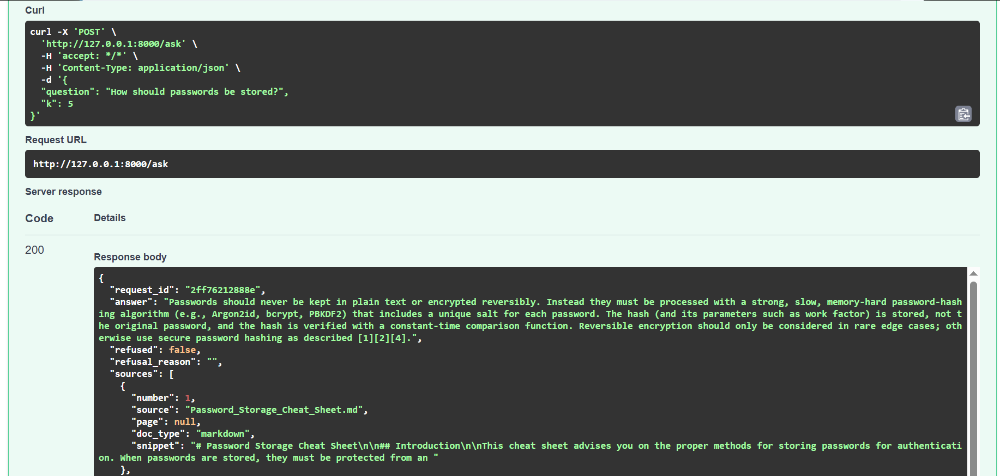
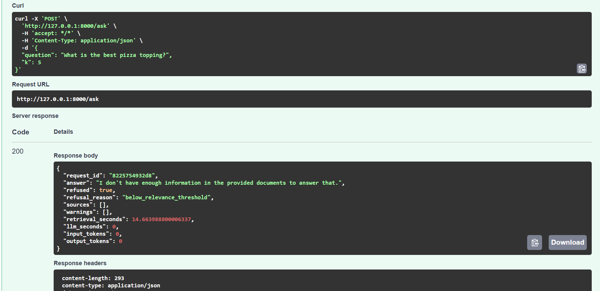

# Enterprise RAG Knowledge Assistant


A retrieval-augmented generation (RAG) system that answers cybersecurity questions from a fixed set of public documents (NIST, OWASP, CISA, NCSC). Every answer carries source citations that the code validates, and the system refuses when the documents do not support an answer. It is built for engineers who need security guidance they can verify.

I wrote the pipeline in plain Python on purpose, so that every stage (parsing, chunking, retrieval, reranking, prompting, citation checking, evaluation) is something I can explain.




## What is implemented

- **Ingestion:** PDF (PyMuPDF, page by page so citations keep page numbers), HTML (BeautifulSoup) and Markdown parsing; removal of repeated headers and boilerplate; overlapping chunking; deterministic chunk IDs so re-running ingestion is idempotent.
- **Storage:** PostgreSQL 16 with pgvector (HNSW index, cosine distance); metadata (source, page, document type) kept in real columns so it can be filtered with SQL.
- **Retrieval:** vector search + BM25 keyword search, merged with Reciprocal Rank Fusion, then reranked with a cross-encoder.
- **Generation:** an LLM answers only from numbered sources, cites them, and uses one exact refusal sentence when the sources are insufficient. Code validates every citation against the sources that were actually provided.
- **Relevance gate:** if the best reranker score is below a threshold, the system refuses before calling the LLM.
- **API:** FastAPI service with request IDs, input validation, logging, and error handling that never leaks internals.
- **Observability (lightweight):** per-stage timings, token counts, an optional cost estimate, a `/stats` endpoint (p50/p95 latency, refusals, errors), and one JSON trace line per request.
- **Evaluation:** a labeled question set, retrieval metrics (Hit@k, MRR), generation checks, an LLM judge for faithfulness and correctness validated against my own labels, and a regression check that CI runs.
- **Engineering:** 45 automated tests that run without a database or LLM, Docker Compose for the database and API, and GitHub Actions (tests, Docker image build, evaluation regression gate).

## Architecture

```text
OFFLINE (ingestion)
  data/raw (PDF, HTML, Markdown)
    -> parse (PyMuPDF per page, BeautifulSoup, Markdown as text)
    -> clean (drop headers and boilerplate that repeat across pages)
    -> chunk (1,000 characters, 150 overlap) -> data/processed/chunks.jsonl
    -> embed (BAAI/bge-small-en-v1.5, 384 dims) -> PostgreSQL + pgvector

ONLINE (POST /ask)
  question
    -> semantic search (pgvector) --+
    -> BM25 keyword search ---------+-> RRF fusion (top 20 candidates)
    -> cross-encoder rerank (top 5)
    -> relevance gate: top reranker score below threshold -> refuse, no LLM call
    -> numbered-source prompt -> LLM
    -> citation validation -> answer + sources
```

More detail on the original design is in [docs/architecture.md](docs/architecture.md).

## Tech stack and why

| Stage | Choice | Why |
|---|---|---|
| Language / API | Python, FastAPI | Typed request validation, automatic API docs; the pipeline blocks, so the endpoint is a plain `def` run in a thread pool |
| Vector store | PostgreSQL + pgvector | One database for vectors and metadata, SQL filters |
| Embeddings | `BAAI/bge-small-en-v1.5` (local) | Free, reproducible, runs on a laptop CPU |
| Keyword search | `rank_bm25` with a tokenizer that keeps IDs like `GV.OC-03` whole | Exact identifiers are weak spots for embeddings |
| Fusion | Reciprocal Rank Fusion | Uses ranks, so cosine and BM25 scores need no calibration |
| Reranker | `cross-encoder/ms-marco-MiniLM-L-6-v2` | Small, CPU-friendly; its score drives the relevance gate |
| LLM | `openai/gpt-oss-120b` on Groq's free tier, via an OpenAI-compatible client | Provider is swappable through three settings |
| Tests / CI | pytest with fakes, GitHub Actions, Docker | Tests need no database or API key |

## Corpus

19 public documents: 8 PDF, 8 Markdown, 3 HTML, producing 1,510 chunks (1,146 PDF, 257 Markdown, 107 HTML). The documents are not stored in this repository. [data/SOURCES.md](data/SOURCES.md) lists each source, its URL and its license.

## Evaluation results

All numbers below come from runs saved in `evaluation/results/`. The evaluation set is small, so treat differences of a few hundredths as noise: with 27 questions, one question moves a metric by about 0.04.

### Dataset (v1.1)

27 answerable questions (each labeled with the gold source, page and an evidence sentence) and 10 unanswerable questions (6 out-of-corpus, 4 near-miss topics the documents do not cover). Most answerable questions were drafted by an LLM and then reviewed by hand; one is handwritten. LLM-drafted questions tend to reuse the passage's wording, which likely favors keyword search. Some questions were removed or rewritten after the first results; every change is recorded in [evaluation/CHANGELOG.md](evaluation/CHANGELOG.md), and the original v1 results are kept in `evaluation/results/retrieval_baseline.json`.

### Retrieval (evidence-level: the retrieved chunk must contain the supporting sentence)

| Retriever | Hit@1 | Hit@3 | Hit@5 | MRR@5 | Sec/query* |
|---|---|---|---|---|---|
| Semantic (vector only) | 0.67 | 0.74 | 0.78 | 0.71 | 0.39 |
| BM25 only | 0.67 | 0.85 | 0.89 | 0.77 | 0.01 |
| Hybrid (RRF) | 0.74 | 0.81 | 0.93 | 0.80 | 0.23 |
| Hybrid + rerank | 0.78 | 0.93 | 0.93 | 0.84 | 5.49 |

\*Measured on a CPU-only laptop after model warm-up; rough values, not production latency.

- Hybrid retrieval found the supporting evidence in the top 5 for 25 of 27 questions versus 21 of 27 for vector search alone (the first, v1 run on 29 questions showed the same pattern: 0.93 versus 0.76).
- The reranker did not change Hit@5. It improved Hit@3 and MRR slightly, at roughly 24 times the latency of hybrid retrieval. Its main role in this design is producing the score the relevance gate uses.

### Relevance gate

On v1.1, the gate threshold of 0.0 (reranker score) refuses 0 of 27 answerable and lets through 0 of 10 unanswerable questions at the retrieval stage. Any threshold from -0.5 to 0.5 gives the same result, so 0.0 sits in the middle of that range. Caveats: the threshold was chosen and measured on the same questions, there are only 10 unanswerable ones, and the lowest answerable top score (0.77) and the highest unanswerable one (-0.59) are close, so rewording a question can move its score by more than a point.

### Generation (threshold 0.0, k=5, `openai/gpt-oss-120b`)

| Check | Result |
|---|---|
| Answerable questions refused | 2 of 27 |
| Unanswerable questions correctly refused | 10 of 10 |
| Unanswerable questions answered anyway | 0 of 10 |
| Answers with valid citations (all citations map to provided sources) | 25 of 25 |
| Answers citing the gold (or an alternate) source | 25 of 25 |
| Faithfulness (LLM judge): faithful / partially faithful | 23 / 2 of 25 (a later rerun of the same system: 22 / 3) |
| Correctness vs reference answer (LLM judge) | 25 of 25 correct |
| Average input tokens per LLM call | about 1,300 |

- **Judge validation:** the judge is the same model as the answerer (a self-preference risk). On 10 answers I labeled myself, it agreed with me on 9 of 10 for faithfulness and 9 of 10 for correctness. That is a rough check, not a statistic.
- **What "partially faithful" looked like:** the model sometimes adds a small detail the sources do not state.
- **Regression gate:** `python -m evaluation.compare_runs baseline current --check` fails when a rate gets worse by more than 0.10 (about 2-3 questions at this sample size). It once failed because the judge was failing intermittently and the metric counted failures as unfaithful answers. I measured the judge's own noise, fixed it (retries, excluding errors from rates, gating on the judge error rate) and did not loosen the tolerance. Details in the CHANGELOG.

## Quickstart (Windows)

Requires Python 3.10+, Git and Docker Desktop.

```bat
git clone https://github.com/kvaruntej24/enterprise-rag.git
cd enterprise-rag
python -m venv .venv
.venv\Scripts\activate
pip install -r requirements.txt
copy .env.example .env
```

Edit `.env` and set `LLM_API_KEY` and `LLM_MODEL` (the default base URL is Groq's OpenAI-compatible endpoint; any compatible provider works). Never commit `.env`.

Download the documents listed in `data/SOURCES.md` into `data/raw/` (any subfolders), then:

```bat
docker compose up -d db
python -m scripts.init_db
python -m scripts.ingest
python -m scripts.load_chunks
python -m scripts.ask "How should passwords be stored?"
```

Run the API and open http://127.0.0.1:8000/docs:

```bat
python -m uvicorn app.api.main:app --port 8000
```

Run the tests (the second command skips the slow model-loading tests, as CI does):

```bat
python -m pytest -q
python -m pytest -q -m "not slow"
```

Run the evaluation (it needs the database, the corpus, and an LLM key):

```bat
python -m evaluation.validate_dataset
python -m evaluation.retrieval_eval my_run
python -m evaluation.gate_calibration
python -m evaluation.generation_eval my_run
python -m evaluation.judge my_run
python -m evaluation.compare_runs baseline my_run --check
```

## API

| Endpoint | Purpose |
|---|---|
| `GET /health` | Checks the database; 503 if unavailable |
| `POST /ask` | Body: `{"question": "...", "k": 5}`. Returns the answer, cited sources (file, page, snippet), refusal status and reason, warnings, timings and token counts |
| `GET /stats` | In-memory counters: requests, errors by status code, refusals by reason, p50/p95 latency, tokens, estimated cost |

Status codes: 200 (an answer or a refusal; a refusal is a valid answer), 422 (invalid input), 502 (LLM service failed), 503 (database unavailable), 500 (unexpected error). Error responses carry a reference ID instead of internals, and the full trace goes to the logs. Refusal reasons: `no_results`, `below_relevance_threshold` (no LLM call is made), `model_refused`.

## Project structure

```text
app/
  api/          FastAPI app and schemas
  core/         settings, logging, metrics, request traces
  ingestion/    loaders, cleaning, chunking
  retrieval/    embeddings, semantic, BM25, hybrid (RRF), reranker, retriever
  generation/   LLM client, context builder, prompts, answer pipeline
evaluation/     dataset, validator, metrics, evaluation scripts, saved results, CHANGELOG
scripts/        ingestion, database, and exploration scripts
tests/          unit tests (use fakes; no database or API key needed)
docs/           architecture, retrieval and generation notes
```

## Design decisions worth knowing

- **Gold labels use source, page and an evidence sentence, not chunk IDs**, so the dataset survives changes to chunking.
- **The relevance gate uses the reranker score.** In an early probe, a raw cosine score let an out-of-corpus question outrank a correct one.
- **Citations are validated by code.** A model once switched to a different bracket style; the validator caught it, and the parser now normalizes citation formats.
- **Ingestion is idempotent**: deterministic chunk IDs plus upserts, so re-running does not duplicate rows and skips chunks that are already embedded.
- **Parsing problems are logged, not hidden**: this is how two HTML files that were empty JavaScript shells were found and replaced.

## Known limitations

- **Small evaluation set:** 27 answerable and 10 unanswerable questions, mostly LLM-drafted. Results are indicative, not proof.
- **Judge:** same model as the answerer, validated on only 10 hand labels.
- **Tables** are extracted as flat text, so row and column headers can be separated from their values. A question that depends on the NIST SP 800-40r4 table was missed by hybrid + rerank, and was refused in my earlier manual runs, even though retrieval found the right page.
- **No OCR** (scanned PDFs would be invisible) and no support for JavaScript-rendered pages.
- **Reranker latency** is about 5 seconds per query on a CPU-only laptop (not profiled beyond stage timings).
- **Single process:** the BM25 index lives in memory, there is no connection pooling, authentication, or rate limiting, and the `/stats` counters reset on restart.
- **LLM free-tier limits:** a daily token limit once blocked a judging run.
- **CI cannot run the full evaluation**, because the corpus and the API key are not in the repository. CI runs the tests, builds the Docker image, and checks the committed evaluation results against the baseline. A stronger setup would use a small public test corpus and a CI secret.
- **Docker:** the API image builds in CI on every push, and I ran the API and database containers together locally with Docker Compose.
- **Not deployed.**

## Future improvements

- Langfuse tracing (an integration plan exists; per-request trace trees and an optional privacy switch for question text).
- Deployment to a cloud platform, with connection pooling and several workers.
- Table-aware parsing, and a chunk-size sweep evaluated on the labeled set.
- A larger evaluation set with more handwritten questions, and an independent judge model.
- Authentication, rate limiting, and a real search engine in place of the in-memory BM25 index.